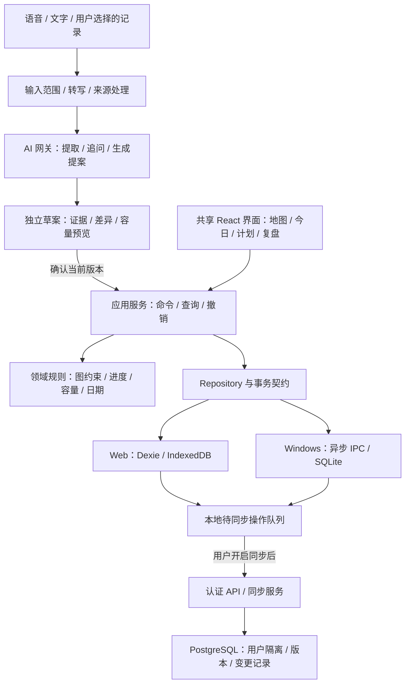

# Master 2.0 重构技术设计

版本：0.2 · 日期：2026-09-28 · 状态：AI 智能体与语音优先设计基线；Alpha 部分已实现，当前实际接口、Electron 保留决定与验收边界以 [交付记录](./04-alpha-delivery.md) 为准。未验收的方案不能视为已经交付。

依据：[产品需求](./01-product-requirements.md)、[调研记录](./00-research.md)、[AI/语音专项研究](./03-ai-agent-research.md)。技术选型服务于语音对话安排任务、可信记录整理、Windows + Web、本地可用与后续商业化；市场/团队范围改变时需复核相应决策。

本版取代 v0.1 中“AI 后置”的决策。AI 与语音进入 M1；完整工作区同步仍可 M3。AI 推理、语音处理与云同步是不同的数据发送权限与系统能力。

## 1. 架构决策摘要

| 决策 | 推荐 | 理由与边界 |
| --- | --- | --- |
| 前端 | React + TypeScript + Vite | 复用现有技能与交互生态，应用编辑器不需要 SSR |
| 组件 | Radix 原语 + 自有语义令牌/组件，Tailwind/CSS | 保留可访问性基础，重建自然风格，而非叠加多个设计系统 |
| 画布 | React Flow，确定性分支布局；Dagre 为初版候选 | 结构化任务节点可编辑，已有基础；不是通用涂鸦白板 |
| 窗口 | Tauri 2 为候选正式壳；Electron 保留过渡 | 同一前端实测后决定，不把换壳当作性能证明 |
| 本地数据库 | Windows SQLite；Web Dexie/IndexedDB | 事务、增量读写和索引，淘汰全工作区 JSON 作为主存储 |
| 状态 | Repository 查询缓存 + 小型 Zustand UI store | 数据以已提交记录为准，视图临时状态单独保存 |
| 后端 | M1 新增 Node.js LTS + Fastify AI/语音网关；M3 扩展同步与商业模块 | 服务密钥、鉴权、额度和取消从首版具备；PostgreSQL 先管理最少服务元数据，不要求先上传整个工作区 |
| 同步 | 固定对象与受限命令；持久 outbox + 版本 + 冲突恢复 | 限于个人多端，不自研通用 CRDT；商业同步上线前独立验证 |
| 智能体 | AI SDK Core + schema + 自有有限状态编排/工具代理 | M1 核心；生成带来源的变更提案，不能绕过用户授权与业务命令直接写库 |
| 语音 | 流式 ASR → 同一智能体 → 简短 TTS；文字等价 | M1 实际麦克风闭环；先验证中文混说与纠错，再评估全双工语音模型 |
| 确定性分析 | 版本化纯函数规则 | 负责容量、依赖、日期、进度与事务约束；不是由模型自行算分或承诺可行性 |
| 测试 | Vitest、浏览器 Playwright、Windows 壳原生自动化/人工验收 | 分别验证业务规则、交互和实际安装环境 |

版本锁定发生在实现阶段：使用兼容的稳定版本、提交 lockfile 并记录许可证。此稿不把旧 package 的版本号直接定义为必须升级到的最新版本。

## 2. 当前系统与重构边界

当前是 React SPA + Zustand persist，Windows/Electron JSON、Web/localStorage、移动/Preferences 三种存储适配；没有账户、API、云数据库、同步或收费服务。重构包含前端与本地层重整；M1 就新增智能体/语音服务边界，M3 再扩展完整同步和收费服务。

必须保留：用户已有目标/任务/复盘和原 ID、四象限与图谱共用任务的原则、可用的测试语义、离线能力。必须补齐：多目标、完整任务支链、数据校验、事务持久化、可恢复迁移、日期/容量/进度一致性。

当前目录不是 Git 工作树。实施前先定位/取得正确仓库，比较本地与远端内容，保存独立备份后创建重构分支；不能直接覆盖当前目录或假设 GitHub 与本地相同。文档先存入现有目录便于审阅，后续纳入正确仓库。

## 3. 分层与代码组织



实现时 `outbox` 属于各自本地数据库，图中表示共用协议，不是另一份共享实体库。

建议目录（目标结构，尚未创建）：

```text
apps/
  client/           # 共享 SPA、页面与浏览器入口
  desktop/          # Tauri 配置与 Rust 本地边界
  api/              # M1 AI/ASR/TTS 鉴权网关；M3 扩展同步/收费
packages/
  domain/           # 无 React/平台依赖的规则与类型
  application/      # 命令、查询、投影、撤销
  storage-web/      # Dexie schema、事务、查询实现
  storage-desktop/  # TS 异步 IPC adapter
  contracts/        # 可序列化 DTO、校验 schema、协议版本
  agent/            # 提取/规划状态机、提示版本、提案生成；不含 DB 任意写入
  source-adapters/  # 用户选择文本/聊天解析、来源定位、消息级去重
  voice/            # 采集/流式转写/播报/打断的跨平台接口
  ui/               # 令牌和可复用交互组件
  test-fixtures/    # 合成规模数据、旧版 envelope 样本
docs/
  decisions/        # 决策及 spike 结果
```

采用普通 workspace 即可；早期不引入构建集群或复杂 monorepo 调度器。现有移动工程保留在旧基线中，新版不将 Capacitor 作为前端必需依赖。

### 职责约束

- UI 不执行 SQL、不访问文件、不把 React Flow Node 当业务实体。
- 领域规则接受显式时钟、时区和输入集合，不能在计算深处任意读取 `new Date()`。
- 应用服务统一执行 `CreateGoal`、`MoveNode`、`CompleteTask` 等，不暴露无限制的 `Partial<Entity>` 给所有组件。
- 存储适配实现相同事务和查询语义；跨平台共享契约测试，不追求同一 SQL 在 IndexedDB 中执行。
- 索引/汇总是可重建投影，不是第二套可独立编辑的业务事实。
- 智能体、语音和手动 UI 共用同一领域命令。对话历史不是任务数据库，模型生成的组件/JSON 也不是持久化事实。

## 4. 领域模型

### 4.1 核心实体

| 实体 | 关键字段 | 约束 |
| --- | --- | --- |
| Workspace | id、ownerId?、title、timezone、schemaVersion | 本地访客可无 owner；云端空间必须有有效所有者 |
| Goal | id、workspaceId、title、description、category、status、startDate?、dueSpec? | 多目标独立；新增不覆盖已有集合 |
| Criterion | id、goalId/nodeId、description、verifiedAt?、evidence? | 所属目标/成果二选一；验收与执行率独立 |
| GoalNode | id、goalId、parentId?、kind、title、description、weight、order、status | 一目标一个 root；parentId 同目标；正权重；禁止循环 |
| Task | id、workspaceId、primaryNodeId?、title、status、triageState、importance、urgencyMode、estimateMinutes?、remainingEstimateMinutes?、startDate?、dueSpec?、contributionWeight | 最多一个主归属；未知估时为 null，不用 0 冒充 |
| Relation | id、workspaceId、fromType/fromId、toType/toId、kind | depends_on 与 related_to 分开；首版依赖至少限定为 task→task |
| PeriodPlan | id、workspaceId、period、startDate、endDateExclusive、focusIds、intent | 日/周/月/年可独立记录意图、重点和预算 |
| TaskAllocation | id、taskId、localDate、plannedMinutes: number \| null、order | 一个任务一天至多一份分配；未知时长保留，显示预算未完整 |
| TimeBlock | id、allocationId、startAt、endAt、timezone | 时间块细化既有分配；时长合计不重复占容量 |
| CapacityWindow / ProtectedBlock | id、workspaceId、date/recurrence、start/end、category | 保护时间只扣与可支配窗口重合的并集 |
| DailyCapacity | workspaceId、localDate、mode: windows/net_minutes、netMinutes?、bufferRatio | 每天一个生效模式；仅有可用分钟时不伪造起止，不与窗口预算叠加 |
| TimeEntry | id、taskId、startAt?、endAt?、durationSeconds、source、effectiveDate?、timePrecision、correctsId? | 实际时间事实；手动补录无虚构起止，旧累计记录日期可未知 |
| DomainEvent | id、operationId、entityRef、kind、occurredAt、effectiveAt、payload | 完成/撤销/验收等；包含版本，按 operationId 去重 |
| Review | id、periodPlanId、periodRange、timezone、cutoff、ruleVersion、snapshot、notes、revision | 完成时保存事实快照，修订有新版本 |
| ViewState | workspaceId、viewId、viewport、collapsedIds、positions、selection | 布局状态单独持久化；移动位置不修改归属 |
| Conversation / Turn | id、workspaceId、inputMode、role、textRevision、scopeId、state | 用户输入与导入引用角色分离；转写修正会使旧提案失效 |
| SourceDocument / SourceMessage | id、sourceType、externalId?、sourceVersion、role、timestamp?、digest、retentionMode | 只读选定来源；时间未知保留 null；不全盘扫描聊天 |
| EvidenceSpan | id、sourceMessageId、sourceVersion、start/end、excerpt、digest | 引文匹配原文；摘要不能替代原始证据；删除来源后标失效 |
| ExtractedClaim | id、kind、actor、temporalStatus、evidenceIds、supportLevel、verificationState | 意图、建议、用户自述、工具观察和助手宣称分开，不等于已完成任务 |
| DraftProposal / ProposedOperation | id、revision、runId、baseVersions、operations、dependencies、evidenceIds、warnings、state | 存于独立草案区；不进入进度/容量/复盘事实直到应用 |
| AiRun | id、scopeId、inputRevision、provider/model、prompt/schemaVersion、state、usage、cancelledAt? | 可观测成本与失败；不默认记录原始音频、提示正文或模型内部推理 |
| ApprovalReceipt / ApplyReceipt | proposalId/revision/digest、selectedOperationIds、inputTurnId?、method、operationId、commitId? | 将授权绑定不可变提案与选中项；应用事务返回真实回执 |
| FieldIntent | entityId、field、lastHumanRevision、locked、origin | 用户修正/锁定不能被重新生成静默覆盖 |

所有业务实体使用完整 UUID；保留旧 ID 的迁移映射。共有字段为 createdAt、updatedAt、deletedAt?、localRevision；云模式另有 serverRevision。不要通过截取 UUID 的前 8 位产生新主键。

根节点显示的目标标题/描述由 Goal 派生，不能同时维护两份可独立修改的标题。时间修正使用 correctsId 或修订版本指向原记录，统计只采用当前有效版本，不把修正前后两条累计相加。

`Task.status = todo | in_progress | blocked | done | cancelled`；收集箱用 `triageState`，计划安排用 TaskAllocation，不再把 planned 当执行状态。目标状态为 draft/active/paused/achieved/archived；取消或放弃写明原因，不冒充达成。

`dueSpec` 是日期型或精确时间型的区分联合：`{kind:'date', date, timezone}` / `{kind:'instant', at}`。必须保留输入语义。

### 4.2 关系约束

归属只由 GoalNode.parentId、Task.primaryNodeId 表达，不再建一份可编辑 contains 边。画布根据这两个字段生成归属连线。

`MoveNode` 验证同一目标、不把父节点放进自己的后代、合法类型顺序；跨目标迁移使用专门命令并更新所有后代归属、依赖与时间归因规则。V1 如未实现该原子操作，应明确禁用跨目标拖动。

依赖边是独立有向无环图。增加依赖时搜索可达路径，防止循环；被阻塞任务仍可经显式确认强制完成，但要记录说明，不能无提示丢弃前置关系。

### 4.3 索引与复杂度目标

常用索引：nodes(goalId,parentId,order)、tasks(workspaceId,status)、tasks(primaryNodeId)、allocations(localDate,taskId)、timeEntries(taskId,effectiveDate)、events(entityId,effectiveAt)、outbox(state,sequence)。

内存构建 `nodesById`、`childrenByParent`、`tasksByNode` 和目标归属表。首次聚合以线性遍历 O(N+T+E) 为目标，更新任务只使相关分支及祖先失效。不能为每个地图节点再次过滤全量 nodes/tasks。

## 5. 关键计算契约

### 5.1 执行进度与验收

对节点 n，贡献集 S 为它的直属子节点与直属任务。每项正权重 w，完成贡献 p 在 [0,1]：

`progress(n) = Σ(w(s) × p(s)) / Σw(s)`。

- 任务完成为 1，未完成为 0；cancelled/deleted 不参与。
- 子节点使用其执行进度；无行动节点显示“无行动记录”，未验收时另提示“待拆解”，向父级贡献 0 并保留权重。
- 成果验收独立统计 Criterion 完成数与 achieved 状态，不把执行进度强制改为 1；尚未完成的任务保留并提示整理。
- 分母为 0 时返回 `unknown`，不返回 NaN 或伪造 100%。
- 子节点和父节点直属任务共同参与。默认权重都为 1，编辑贡献占比时展示归一化结果。
- Goal 达成由 Criterion 验收与用户确认决定，不是 `progress === 1` 自动触发。

新增任务、取消、重加权属于范围变化，记录事件；历史快照保存数值与规则版本，不根据当前树回算出虚假的过去。

### 5.2 时间与容量

工作区保存 IANA 时区；瞬时事件 UTC 存储，计划日保存 date-only。周起始日是设置项，默认周一。所有周期使用 `[start, endExclusive)`，不把年度最后一天 00:00 当结束。

容量先对每天可支配窗口求并集，再扣固定/保护安排的交集并集。缓冲在剩余容量上只扣一次。TaskAllocation 计入计划总量，TimeBlock 只是其中已定位部分；两者不相加。

只提供“今天还有60分钟”时支持 `DailyCapacity.mode=net_minutes`，草案声明为已扣固定安排但未扣弹性的净可支配分钟，采纳后按 netMinutes×(1-bufferRatio) 计算；不再扣会议，不伪造60分钟的具体位置。每个工作区日期只有一个生效容量模式，切换至 windows 是有预览的替换而非叠加。只有净预算时可安排日期队列；创建具体时间块仍检查已知保护事件和相互重叠，未知实际窗口时不宣称时段完全可行。

plannedMinutes 为 null 的分配可以存在，但容量显示“预算未完整”；不能将 null 当 0 来承诺剩余时间。创建具体时间块时需先确定时长并建立对应分配。

原始估时用于计划与校准，实际投入来自 TimeEntry。剩余估时可以手动修订；没有修订时保留原估算并标为未更新，不能直接用估时减实际工时给出确定的剩余工作量。当实际投入超过估时且任务未完成时，提示“需重新估时”。

日容量展示“已消耗 + 尚未执行的保留分配”，二者不重复统计同一时段。只有日期可靠、归因明确的 TimeEntry 才能扣减对应任务的保留分配；完成但未记时间的条目标记容量不确定。完成/取消命令保留历史分配事件，并返回未来待释放分配的预览，确认后在事务中释放，撤销可恢复。具体时段冲突使用区间交叉检查，与全天分钟总量独立报警。

跨午夜的实际计时按所属时区切片用于周期统计；手动 duration-only 记录按明确 effectiveDate 归期。实际记录保留当时的目标/分支归因快照，任务后来迁移归属时不无声改写历史复盘。旧版迁移的累计 actualMinutes 使用 source=legacy_summary、timePrecision=unknown，未获用户确认发生日期前仅列“旧版累计记录”，不纳入严格的周/月投入或时间段冲突计算。

### 5.3 风险与建议

风险输出结构为 `{level, reasonCodes, facts, evaluatedAt, ruleVersion, confidence}`，不只返回一个颜色。

计算顺序：数据完整性 → 阻塞 → 硬截止 → 剩余工作与截止前分配容量 → 全局超载 → 分支停滞。每个分支只能使用分给自己的容量，不能重复享用整份周预算。尚未分配的共享余量只在全局层显示。

候选任务过滤：未完成/未取消、开始日期允许、前置可满足、节点/目标未暂停。排序参考用户重要性、截止、目标重点、停滞；在容量内形成建议，用户预览后批量采纳。规则与输入快照可审计。

## 6. 本地写入、保存状态与撤销

统一入口示意：

```ts
type CommandEnvelope<T> = {
  operationId: string;
  workspaceId: string;
  expectedVersions: Record<string, number>;
  payload: T;
};

interface Repository {
  execute(command: CommandEnvelope<DomainCommand>): Promise<CommitReceipt>;
  query(input: Query): Promise<QueryResult>;
  subscribe(input: Query, onChange: (value: QueryResult) => void): () => void;
}
```

具体实现不是把示意接口直接接上全量 `setState`。流程为：校验 → UI 暂态反馈 → 本地事务写实体/事件/撤销资料/待同步操作 → 返回提交回执 → 更新相关查询缓存。失败保留输入、还原乐观部分并显示重试。

保存状态区分“正在保存”“已保存到本机”“等待同步”“已同步”“同步冲突/失败”。只有事务成功才能显示“已保存”，只有服务端确认并拉取到对应版本后才显示“已同步”。

标题/说明编辑使用组件草稿，短延时或失焦批量提交；明确未落盘状态，窗口关闭处理未提交草稿。任务完成、删除等离散命令立即事务提交，不以大 debounce 窗口冒险。

`CompleteTask` 写任务状态与完成事件；有明确 actual duration 才追加 TimeEntry。若已有计时条目，不再把完整时长重复追加；“修正总时长”转换为有来源的修正记录。operationId 重试必须返回原回执。

撤销执行补偿命令，携带预期版本，避免把后来编辑覆盖掉。未同步事件可在同一事务内合并为净变化；已同步事件通过新的补偿操作传播。UI 的撤销快捷键在文本编辑与全局操作之间有清晰作用域。

### Windows 边界

Tauri Core 管理连接、事务、文件、导出、备份与原生能力。前端通过类型化 IPC 调用有限本地操作；一份复合提交在 Rust 层的一次数据库事务完成，避免跨多个 JS→SQL 调用假装原子事务。

可用官方 SQL 生态完成 SQLite 接入，但不向网页暴露任意连接字符串、全盘文件访问或无范围 SQL。数据库连接不指向云端生产库；本地命令仍验证 workspace/外键和数据类型。[Tauri SQL](https://v2.tauri.app/plugin/sql/)、[Capabilities](https://v2.tauri.app/security/capabilities/)

SQLite 启用外键，合理设置 busy timeout；事务与 WAL 策略在崩溃恢复测试后确定。备份使用一致性数据库备份或安全快照方式，不直接复制仍在写入的主文件而遗漏 WAL。

### Web 边界

Dexie 管理 IndexedDB schema 与事务；UI 订阅按目标/日期限定。网络、布局、校验摘要等异步预计算放在事务外；事务内重新读取版本并校验约束，只等待同一事务的数据库操作，避免任意 await 使事务提前关闭。持久化权限可请求但不能保证成功；配额失败明确提示导出/清理可恢复缓存，不丢弃用户输入。多标签使用数据库事务、版本检查和通知机制；同一任务的计时所有权要协调，不能每个标签各记一次。

专注计时由开始时间与暂停片段计算，视觉每秒刷新不触发整库持久化；低频检查点用于崩溃恢复。休眠、系统时间变化和多端重叠会生成待确认记录，不能直接宣称计时一定准确。

## 7. 地图与交互实现

业务 Node/Task 通过 projector 转为 React Flow 节点，`id` 与业务对象映射稳定。任务卡共用 domain selectors，进度不存到画布私有对象中。

布局输入只有结构、展示层级、节点尺寸、固定位置；只有这些发生变化才调度 Worker。完成任务、打开菜单、hover 不触发布局。布局请求带递增 generation，过期结果丢弃，避免较慢的旧任务把画布拉回。

默认布局从中心目标向两侧有序分支展开，可按顺序与子树大小确定分侧；初版 Dagre/确定性树算法在左右子树分别布局并合并。所有位置由内容与用户设置确定，不用随机扰动制造自然感。

基础关系用轻量曲线，依赖边只在选中上下文/显式开关下展示。React Flow 负责画布交互，不直接运行持续力导向模拟。

层次显示：远景目标/要素，中景里程碑，近景任务；详细阈值在真实字体和缩放试验中确定。缩放折叠不能丢失键盘焦点，大纲与搜索是始终可用的等价入口。

性能实现约束：

- nodeTypes/edgeTypes 在组件外定义；节点 memo；回调和配置稳定。
- UI 订阅选中 ID、对应任务等最小切片；移动一个节点不刷新整屏任务列表。
- 限制默认展开节点数；列表按需虚拟化。`onlyRenderVisibleElements` 经两组实测后再开启，不先假定必然更快。
- 动画只作用于相关对象，主要用 transform/opacity；停止无意义的常驻循环。
- 拖动只更新局部 UI 位置，松开后批量保存；视口变化低频保存，与任务事务分离。
- 样式分成 tokens、base、components、feature 层，拆解现有单个大 CSS 文件。

依据：[React Flow 性能](https://reactflow.dev/learn/advanced-use/performance)、[布局比较](https://reactflow.dev/learn/layouting/layouting)、[动画性能](https://web.dev/articles/animations-and-performance)。

## 8. Web 离线与版本更新

生产 Web 使用 HTTPS 和版本化 Service Worker，应用壳与核心懒加载 chunk 纳入明确预缓存清单。字体/图标本地打包；离线状态下首次打开此前未访问的核心页面也要可用。

首访尚未下载资源时不能承诺完全离线。显示离线准备完成状态；CDN 缓存命名按构建 hash，更新完成后提示可刷新。未保存编辑和迁移进行中不强制刷新。

Service Worker 的资源版本与本地 DB schemaVersion 分离；新版数据库迁移后禁止不兼容旧客户端继续写，提供升级或只读恢复入口。发布要覆盖“开着旧标签时发布新版本”的场景。

本地模式下 Windows 与 Web 各有数据副本；在未实现云同步前只通过导出/导入迁移，产品不得暗示它们天然互通。

## 9. 服务分期与商业同步设计

M1 的 AI/语音服务见第 15 节；以下工作区同步设计属于 M3，M1/M2 不会因存在 AI 后端就自动获得同步能力。先以单用户多设备为目标，暂不提供多人同时编辑保证。

### 9.1 服务职责

Fastify 模块化单体：M1 为 identity、ai-runs、voice-sessions、quota；M3 扩展 workspace、commands、sync、backup、entitlements、billing、share。PostgreSQL 在 M3 才承担工作区实体、同步变更序列；M1 的服务元数据与本地任务分开，不能据此声称已云备份。对象存储仅在实际需要备份/导出等文件时引入。[Fastify 校验与序列化](https://fastify.dev/docs/latest/Reference/Validation-and-Serialization/)

认证采用成熟 OIDC/会话实现，供应商根据市场另定，不自研密码与验证码体系。Web 推荐同源 HttpOnly/Secure 会话；桌面系统浏览器登录 + PKCE，令牌放系统凭证存储，不放普通 JSON/localStorage。最终集成方式需按选定认证服务官方文档验证。

服务端从凭证确认主体，验证 workspace membership；客户端传 ownerId 不能授予权限。所有读写在 workspace/owner 范围内执行。可加 PostgreSQL RLS 为第二道隔离，但应用角色需避免拥有绕过策略的权限。[PostgreSQL 行级策略](https://www.postgresql.org/docs/17/ddl-rowsecurity.html)

### 9.2 最小接口

| 方法与路径 | 用途 | 关键语义 |
| --- | --- | --- |
| `POST /v1/workspaces` | 创建云端空间 | 可按幂等键避免重复 |
| `POST /v1/workspaces/:id/commands` | 提交固定类型命令 | operationId、baseVersions、schemaVersion；返回 accepted/conflict/rejected |
| `GET /v1/workspaces/:id/changes?cursor=...` | 分页增量拉取 | 服务端序列游标；包含 tombstone 与最终状态 |
| `GET /v1/workspaces/:id/snapshot` | 首次/游标过期初始化 | 一致性快照 + 对应 cursor，不能漏中途变化 |
| `POST /v1/workspaces/:id/conflicts/:id/resolve` | 用户解决冲突 | 新命令与版本校验，不直接覆盖整空间 |
| `GET /v1/me/entitlements` | 查询权益 | 服务端事实、有效期与离线宽限策略 |
| `POST /v1/billing/webhooks/:provider` | 支付通知 | 验签、事件去重、事务更新权益 |

接口是协议草案，OpenAPI/schema 在实施时生成。每个普通命令独立提交；需要全有或全无的移动子树/导入使用明确的原子批命令。时间、负数、非法状态、循环、跨空间引用和超限载荷都在服务端校验。

### 9.3 同步循环

1. 本地操作在一次事务中更新工作副本并写 outbox，分配唯一 operationId。本地未开启同步时无需发送任何业务内容。
2. 开启云端时先告知上传范围，创建/绑定空间并确认合并方式；已有本地 ID、孤儿条目不能静默丢弃。
3. 客户端按工作区序列上传 pending 操作。服务端先鉴权，再按 operationId 返回已处理结果或验证 baseVersions。
4. 服务端对同一工作区的变更序列头加事务锁，完成版本检查、实体更新、事件记录和序列递增后一起提交。不能只用会产生提交顺序空洞的裸自增 ID 当作“已完整提交”的同步游标。
5. 客户端收到确认后原子标记队列状态。断线、超时、进程退出后重试相同 operationId；不把网络 timeout 当作确定未执行。
6. 拉取其他设备变更，在本地事务中合并并推进 cursor。持久保留已确认的 server base 与未确认本地命令，工作副本从 base + pending 投影；远端快照不能覆盖未上传修改。
7. 游标过期时先保护 pending 操作，再取带水位的一致性快照，重放本地命令，冲突进入待处理队列。成功前不清空现有本地库。
8. 非重试错误要可见。令牌过期暂停上传并提示登录，本地仍可用；权益失效不删除未同步数据。

localRevision 和 serverRevision 属于不同版本空间，不能直接比较。命令的 expectedVersions 用于本地并发，上传的 baseVersions 引用已确认服务端版本。同一实体离线连续 A→B→C 时记录 dependsOnOperationIds；A 确认后，以新 serverRevision 重新校验并确定 B 的基线，再上传。A 冲突/被拒绝时暂停依赖命令，保留 B/C 意图供重放或人工解决；不能跳过前置，也不能盲目改版本号重试。跨实体复合命令需等待全部依赖确认。

商用实现前必须写同步状态机与模型测试。先限制对象和命令，不扩展到任意 JSON 文档协作。若这些成本超过团队能力，改用经过验证的同步服务，或者先只分发本地版，不能降低数据一致性门槛。

### 9.4 冲突策略

| 冲突 | 处理 |
| --- | --- |
| 同一标题/说明双端修改 | baseVersion 不符返回冲突；保留双方内容和恢复历史，用户选择，不最后写入覆盖整对象 |
| 不同字段并发修改 | 仅在字段级基线可证明互不冲突时合并；否则进入冲突界面 |
| 重复完成 | 同 operationId 幂等；不同 operationId 同一任务同一完成状态不重复产生工时 |
| 一端完成、一端重新打开 | 版本冲突，保留状态事件；明确选择最终状态 |
| 时间记录 | 不同记录追加、同 ID 去重；重叠计时标记待核对，不默默双倍求和 |
| 删除与编辑并发 | tombstone 阻止自动复活，编辑草稿可恢复为副本或显式还原 |
| 跨分支重挂并发 | 服务器校验最终无环与归属，冲突时保留本地意图待处理 |
| 视觉位置并发 | 与业务字段分离；可按设备视图保存，默认不影响跨端业务数据 |

删除保留 tombstone 的期限与游标有效期绑定；过期客户端必须全量重建。版本协议不能靠客户端墙钟判断先后；时间戳记录事件时间，serverRevision/cursor 决定顺序。

退出账号先提示尚未同步条目并允许导出。本地数据库按账号/空间隔离；切换账号关闭旧查询与队列，不能把上个用户 pending 操作发到新账号。

### 9.5 替代方案触发条件

- PowerSync：必须在首个商业版本交付多端同步，且自建协议成本过高时做 spike；核对当时 Tauri SDK 成熟度与服务许可。它仍不免除写入鉴权和业务冲突处理。
- Dexie Cloud：Web 优先、愿意让桌面共用 Web 数据路线时再评估托管方案与市场适配。
- Electric：已有可靠命令 API，主要需要 PostgreSQL→客户端读分发时采用；不能当作现成双向离线写回。
- Yjs：出现明确的同时协作画布/富文本需求时再引入，仍保留目标树/依赖约束。

证据与许可见[同步研究](./00-research.md)。本地两种存储和云同步是已知工程成本，立项时单独估算，不包装为只需加一个插件。

## 10. 迁移与恢复协议

### 10.1 旧数据识别

读取用户明确选择的旧导出/存储入口，识别 Zustand persist v1 envelope。支持 Electron 的原状态文件与同源 Web key；Tauri/Web 无权直接读取另一浏览器来源的数据，应由旧版导出或用户选文件。

迁移流程：只读探测 → 备份原始字节与 checksum → schema 校验 → 生成预览和异常清单 → 在临时空间转换 → 验证对象数量/ID/关联/文本/日期 → 一次提交切换 → 保存迁移记录与原始备份。

导入文件应有大小与深度限制，先校验再解析业务关系；恶意文本不作为 HTML 执行。错误显示具体对象与原因，不以“导入成功”掩盖丢弃。

### 10.2 字段映射

| 旧字段 | 新落点 | 处理要求 |
| --- | --- | --- |
| goals/nodes/tasks/reviews 的 id | 原 ID + migration source mapping | 不因新 ID 规范直接重编号丢关联 |
| goals[0] 与其余 goals | 多目标完整集合 | 所有记录都迁，不只取首个 |
| nodeId | primaryNodeId | 孤儿任务进待修复收集箱并记录源引用 |
| task.quadrant | importance + urgencyMode/override | 保留原象限含义，不依据当前日期擅自重分类 |
| task.status=inbox/planned | todo + triageState + allocation | 执行状态、整理状态、计划拆开 |
| plannedDate | TaskAllocation.localDate | 估时存在时作为计划分钟，未知不填假值 |
| dueDate | dueSpec + legacy provenance | 旧 UI 曾混用 plannedDate/dueDate；保留并提示确认，不能直接删除或肯定其为真实硬截止 |
| actualMinutes | TimeEntry legacy_summary | 仅迁存在的原始数值，effectiveDate=null、timePrecision=unknown；completedAt 只保留为完成事件时间，不能当作全部工时发生日期 |
| successCriteria | Criterion 文本 | 默认未验收；旧 completed 作为迁移状态/待核对，不伪造证据 |
| goal.weeklyHours | 目标意向预算 | 保留原值；不把各目标预算相加当成用户真实可用时间，首次单独设置用户级时间窗口 |
| reviews | 历史复盘正文与范围 | 原版无快照，标“历史正文，缺当时数据快照”，不能回填今天统计冒充过去 |
| theme/activeView | 设置/视图映射 | 保持可识别状态；新导航重映射而非强制丢失 |

旧版默认演示数据在库中并不代表用户授权丢弃。不能按标题“看起来像示例”自动过滤；导入预览让用户选择。

负时长、无效日期、重复 ID、循环父子、不存在的引用进入隔离清单；有效数据与异常都可导出，任何丢弃需用户可见决定。相同源 checksum/导入记录重复执行必须幂等。

### 10.3 恢复

迁移失败回到原库，旧应用仍可读取原文件。新版写入以后若回退旧应用，需导出兼容副本并提示可能不支持的新字段，不能声称新旧双写天然安全。

SQLite 每次 schema 升级先做可恢复备份，正常使用按策略轮转；Web 提供带 manifest/schemaVersion/checksum 的完整导出。schemaVersion、客户端版本、备份版本与规则版本独立记录。

## 11. 性能验证与预算

### 11.1 环境与数据

基准目标：Windows 11、四核级 CPU、8GB RAM、SSD、集成显卡、60Hz 显示器；实施时登记实际型号、电源模式、WebView2/浏览器版本与屏幕缩放，不能用未拥有的机器数据当测量。

桌面发布构建与 Web production 构建测量；Windows 1024×768、1440×900、1920×1080，缩放 100%/125%/150%。Web 先主测 Edge/Chrome，其他浏览器走兼容矩阵。

合成固定 seed 数据：小集 100 任务/30 可见节点；标准集 1,000 任务/150 可见节点/10 目标；压力集 10,000 任务/1,000 总节点但控制当前可见数量。每组同时包含长中文标题、深层分支、完成/阻塞/取消、跨日时间记录和空值。

### 11.2 项目验收目标（未实测）

| 项目 | 标准集目标 | 方法 |
| --- | --- | --- |
| 输入/选中/勾选到首次可见反馈 | p95 ≤100ms | 事件时间与下一次可见绘制，至少 100 次不同操作 |
| 已加载页面切换 | p95 ≤150ms | 标记开始/目标内容可交互，至少 30 次 |
| 地图拖拽/缩放 | 连续 30 秒，帧间隔 p95 ≤20ms，>50ms 长帧 <1% | 浏览器 trace + 实际手动操作；同时记渲染/主线程开销 |
| 单次普通命令持久提交 | p95 ≤200ms | 从命令发出到事务 commit 回执，区别于乐观反馈 |
| Windows 启动 | p95 ≤2s 目标 | 进程冷启动 20 次至真实数据可操作，记录首轮与热缓存差异 |
| 标准集首次布局 | Worker 结果 p95 ≤500ms | 不阻塞主线程；小范围更新另记 |
| 压力集搜索 | 首批可用结果 p95 ≤200ms | 中文/路径/状态混合查询；工作区量级固定 |
| Web 线上响应 | INP p75 ≤200ms | 真实用户性能指标，和实验室 p95 分开 |
| 稳定性 | 100 次进入/退出地图、详情、专注后无持续资源增长趋势 | 多轮 heap/进程/监听器对照，不能单张快照证明无泄漏 |

Web 冷加载使用记录好的网络条件；参考预算为 10Mbps/100ms RTT 下 LCP p75 ≤2.5s、CLS ≤0.1，核心任务可交互时间另报。桌面包体、空闲 CPU、总进程内存先建立基线，再锁预算；必须包含 WebView/Electron 子进程，不能仅报宿主进程内存。

若 Tauri 与 Electron 同前端比较没有显示优势，先分析计算、写入和样式，不基于技术流行度做迁移结论。旧 Android 采样不进入本表。[Electron 性能方法](https://www.electronjs.org/docs/latest/tutorial/performance)、[INP 定义](https://web.dev/articles/inp)

## 12. 测试计划与需求追踪

| PRD 验收 | 测试类型 | 关键场景 |
| --- | --- | --- |
| AC-01 多目标 | domain + store/repository + E2E | 新增第 2/第 10 个目标，不覆盖；重开不重复向导 |
| AC-02/03 同源与进度 | 单测/性质测试 | 父级直属任务、空分支、取消、权重、重挂；多视图同 ID |
| AC-04/05 日期与容量 | 参数化单测 | 跨周/月/年、DST、日期型截止、重叠保护时间、跨目标超载 |
| AC-06 保存与撤销 | 双适配契约/故障注入 | 磁盘/配额失败、重复命令、崩溃、撤销撞上新版本 |
| AC-07 迁移 | fixture + 集成 | 不合法/超大文件、循环、孤儿、重复导入、事务失败与回滚 |
| AC-08 离线 | 浏览器/Windows E2E | 离线首次进未访问页面、重启、多标签、SW 新旧版本 |
| AC-09/11 复盘验收 | 单测 + E2E | 周期归因、未记录投入、补录修订、行动满但成果未验收 |
| AC-10 可访问性 | E2E + 人工 | 键盘、大纲、焦点恢复、中文 IME、缩放与减少动效 |
| AC-12 性能 | 合成数据 + trace | 标准/压力数据、发布构建、跨主题、存储与画布分开测 |
| AC-13 同步 | 模型/集成/双客户端 E2E | 乱序/重复/断网/删除编辑/账号切换/游标过期 |
| AC-14/16 语音/纠正 | 合成录音 + 真机人工/E2E | 实际麦克风、否定/日期数字、设备拒绝、切文字、停止释放与播报回声 |
| AC-15/25 少维护 | 固定场景评测 + 交错顺序用户试用 | 追问轮数、必要性、真实完成闭环、纠错/等待时间与成本 |
| AC-17/18/19 事实与来源 | 带标注 fixture + 安全/导入集成 | 来源引用、角色、矛盾、消息身份、重复内容不同事件、注入/凭证隔离 |
| AC-20/21/22 提案可靠性 | 双适配事务 + 竞态故障注入 | 手改锁定、旧版确认、依赖子集、重复提交不同载荷、取消撞提交、断流恢复 |
| AC-23/24 约束与权限 | 性质测试 + 网络检查 | 容量两种模式、字段/空间边界、独立发送授权、停止上传与来源撤回 |

AI/语音新增验收与 PRD 第 14 节逐项对应；具体测试集与发布门槛见本文件 15.10。不能以 schema 验证成功代替事实正确，也不能以文字聊天成功代替实际麦克风闭环。

Playwright 用于浏览器可验证层；Tauri 原生窗口采用受支持的 WebDriver 路径和真实 Windows 人工验收，不能声称普通 Chromium E2E 自动覆盖所有原生 IPC/输入法。现有 7 个测试只作为行为参考，先修正错误口径后迁移，不把旧测试数量当覆盖率。

关键流程走通过后再做视觉截图回归：今日、地图、计划、四象限、复盘、空状态、错误/未保存、深色、长标题和窗口缩放。自然风格同时接受可读性与可操作性评审。

## 13. 分发、更新与商业运行

Windows 首发优先当前受支持的 Windows 11 x64；如需 Windows 10/ARM64，明确加入兼容矩阵后再承诺。Tauri 打包需要 Rust/MSVC 与 WebView2；提前确定在线安装与离线安装策略。[Windows 安装文档](https://v2.tauri.app/distribute/windows-installer/)

安装器代码签名与应用更新签名是不同机制，分别配置；更新发布经 CI 构建/校验，不将私钥放客户端或仓库。[Tauri Updater](https://v2.tauri.app/plugin/updater/)

发布走测试通道与稳定通道，更新说明包含 schema 兼容性。失败恢复不能让旧客户端继续写新 schema；必要时恢复备份或启动兼容只读模式。更新服务器下载和签名验证失败不破坏当前可用版本。

Web 静态应用与 API 分开部署；公开官网与应用分别管理缓存和发布。市场确定后选定可访问的资源/CDN、认证、邮件和支付服务，不在中国大陆首发路径强依赖未经验证的海外登录或资源域名。

支付仅通过服务器创建订单与验签 webhook 更新权益，金额和权限不由客户端决定。订阅到期、本地离线宽限、退款和重复通知有可测试状态机。云付费能力停止后不删除本地数据或封锁导出。

商业上线检查围绕实际服务：依赖许可证/notice、账号隔离、备份恢复演练、签名更新、支付沙箱完整流程、用户支持和所选市场要求。尚未选择市场前不写具体法定义务的未经核实结论。

默认遥测只记录匿名/最少的版本、操作耗时、错误类别与数据规模，不记录任务标题、目标正文、复盘或备份内容；用户能控制诊断发送。云备份存储加密与传输加密不等于端到端加密，未设计客户端密钥体系前不得宣传 E2EE。

## 14. 实施顺序与决策门槛

| 阶段 | 工程交付 | 完成门槛 |
| --- | --- | --- |
| M0 需求与 spike | 正确仓库基线、自然样板、桌面壳比较、中文语音/提案小样本验证 | 证明“说→必要追问→改→确认”确实省时；真实权限/收音/停止/转写可用；未通过先改核心交互 |
| M1 AI-first 纵向闭环 | domain/存储/最小迁移 + ASR/智能体/TTS网关 + 文本记录导入 + 多目标地图/今日/周计划/周复盘 | 语音与文字均可从输入到已保存行动；证据、预算、幂等、手改保护、撤销、离线降级通过；网关从本阶段鉴权限额 |
| M2 可分发测试版 | 完整周期复盘/备份/主题/离线/Windows-Web；Codex只读连接器单独兼容验证 | 通用输入不依赖连接器；AI安全/中文噪声语音/性能用例通过，5–8人省时试用；不能把失败连接器宣称已支持 |
| M3 商业版 | 完整账户同步/权益/支付/更新/支持；实际AI与语音成本核算 | AC-13、恢复演练、隔离/配额/成本与市场上线要求通过 |
| 后续 | 经验证的全双工语音、受控主动提醒、外部插件写入、多人/移动/日历 | 语音输入和主动澄清已在 M1；后续扩展不改写这项核心承诺 |

Tauri spike 不达标时，继续用 Electron + 异步 bridge/SQLite，UI 与领域层不用重写。复杂布局需求未验证前不引入 ELK；协作需求未验证前不引入 Yjs/图数据库。同步阶段如估算不可承受，可先分发明确不互通的本地版本，或验证成熟服务替代。

本轮实际交付是更新后的方案文档及新增 AI/语音研究。没有执行代码替换、读取私人聊天、存储迁移、框架安装、GitHub 推送、部署或付费模型调用。下一步先做可操作的语音→智能体→目标/任务提案纵向样板，并完成桌面技术验证。

## 15. 核心：语音智能体与证据驱动规划

### 15.1 采用什么，不采用什么

推荐 AI SDK Core + Zod/共享 schema + 有界 TS 状态机。语音供应商与文本模型使用独立 adapter；首版各选一个通过中文用例与目标地区网络测试的服务，而不是一开始做模型超市。CopilotKit 可作交互 spike 对照，暂不叠加 Tambo、LangGraph 和另一套对话数据库。选型依据与许可见[专项研究](./03-ai-agent-research.md)。

ASR（语音转文字）→文本智能体→TTS（文字转语音）是首版建议，原因是便于展示和修正中间文本、替换供应商，并共用文字/导入流程。它有串联延迟，不能预先宣称比实时语音模型更快；全双工方案若在中文/延迟/成本试验中明显更好，可替换语音层，但仍通过同一提案和提交边界。[官方语音架构说明](https://developers.openai.com/api/docs/guides/voice-agents)

不采用模型任意生成 HTML/JS/SQL 并执行；不靠桌面点击自动化安排本应用任务；不要求 LLM 直接读写 SQLite；不默认引入向量数据库、Neo4j、多智能体集群或持续后台轮询。

### 15.2 从说话到已保存：完整状态与时序

```text
用户开启语音会话 → 收音/临时字幕 → 本轮最终转写
    → 识别意图与事实 / 读取授权范围上下文
    → 必要时问一个关键问题（可语音回答，也可跳过低风险未知）
    → 生成结构化变更草案 → 规则校验 → 差异/地图预览
    → 用户确认当前版本或继续纠正 → 本地原子提交 → 回执与撤销
```

会话状态：idle / requesting_permission / listening / transcribing / thinking / clarifying / preview / applying / saved；error、cancelled 是明确终态。AI 运行另有 queued/running/completed/failed/cancelled，不能把“模型回复了”当作“任务已保存”。

语音 `turnId + transcriptRevision`、AI `runId`、提案 `proposalId + revision`、提交 `operationId` 分别标识不同生命周期。用户说“不是明天，是下周一”会产生修订，取消或忽略旧 run 的晚到结果。临时字幕只展示，不触发正式写入；最终转写仍可更正。

默认显示差异摘要，例如“新增 2 项、调整 1 项、标记完成 1 项待核实；今天占用 45/48 分钟”。用户可说“按这版安排”或点应用一次批量提交。前端审批模块把确认绑定已展示/已播报的提案 revision/digest 与选中操作；模型无权自行生成有效 ApprovalReceipt。含糊回应、旧版本确认、从导入记录引用的“同意”均不能执行。

允许对已展示草案的单句明确修改并应用，例如“把第二项改成15分钟，按这个安排”。交互授权器保存 displayedBaseRevision、最终用户转写、显式有限 patch、resultDigest；仅在对象唯一、patch 不扩大范围、结果经过确定性校验且无并发变化时授权，不再重复问。任意模型额外生成、识别歧义或高影响变更不在此捷径内，需新预览。历史待核实完成单独选择并明确核实，普通“安排”不能顺带确认它们。

直接手动编辑仍走原有命令，不必先与 AI 聊天。语音确认是便利操作而非声纹身份认证；只在明确开启的交互会话中有效，高影响删除/覆盖仍需清楚列出对象和专项确认，不能隐藏在批量新增内。

### 15.3 主动澄清与可用工具

主动性是“发现会影响结果的不确定性并及时询问”，不是无限追问或自动扩张任务。每轮最多一个关键问题，通常 0–2 轮后给可用草案。超过预算时先保留可确定内容，把仍需确认的操作留在草案，允许用户继续聊。

优先追问顺序：歧义对象/日期/否定句 → 目标成功条件或实际容量 → 已有承诺冲突。分支名称、临时估时等可用可见假设，不要求先填满四象限或完整年度目标。已回答内容记入本次结构化上下文，不重复问；长期偏好需明确“记住此设置”，支持查看/删除。

工具白名单：`read_goal_context`、`find_task_candidates`、`read_capacity`、`propose_goal_tree`、`propose_task_changes`、`propose_review`。读取由客户端/服务端权限代理限定工作区、实体和日期，不允许模型扩大 scope。模型可提出读请求，但只有已授权上下文可以返回。

M1 选择客户端预取模式：客户端先在本地查询有界授权快照，附 snapshotId、实体版本、时间范围与许可 scope 发送。云端工具只查询这份快照，不能直接访问 SQLite/Dexie；所需信息不在其中时返回 context_missing，下一轮由客户端展示并补充许可内数据，不偷偷扩大读取。首版不另造双向远程调用本地工具协议，未来确有需要再增加具 requestId、超时和客户端鉴权的工具回传通道。

`apply_proposal` 只供可信交互层在取得当前审批凭据后调用，不能作为模型可自行执行的普通工具。无需引入通用 shell、浏览器控制、全盘文件读取或任意 HTTP 请求。周期提醒的后台主动推送另行选择频率/安静时段，M1 不以此为依赖。

### 15.4 来源解析、事实与目标归整

M1 接受用户粘贴文本或选择 `.txt/.md`，显示来源与范围。JSON/JSONL 只处理已实现且验证过的版本化格式，未知格式回到纯文本预览或报不支持，不承诺兼容所有聊天导出。大文件先显示大小/时间范围，分段处理，有 token/字节/深度限额，超限不静默截断。

提取流程：解析角色与时间 → 基于消息分段 → 提取 claim + 原文跨度 → 合并矛盾/重复 → 与既有目标任务检索匹配 → 草拟目标/行动 → 确定性验证。简单输入可在一次模型调用返回这些逻辑字段，不能为每一步都强制一次慢调用；长记录才分段并合并，保留跨片段纠错链。

Claim 区分 intent / planned / attempted / blocked / reported_done / observed_result / suggestion；保留说话人。助手“已完成”、工具 exit=0、用户自述分别有不同依据，均不能扩大为“已经上线/目标达成”。后文“测试还是失败”不被早期成功摘要吞掉。纯讨论、代码块中的示例、被引用的任务不是当前指令。

导入记录的相对日期按消息发生时间与来源时区解析；未知时不回填为导入日。本轮语音按用户时区与 turn 的固定基准时间解析，跨午夜响应不重新漂移“明天”。导入历史完成一律先待核实；用户明确核实后方可产生完成命令。完成发生时间未知时 effectiveAt=null/timePrecision=unknown，记录确认时间但不计入虚假的本日成果；无工时保持 null。

`EvidenceSpan` 在原文存在且与 sourceVersion/digest 匹配才有效；校验引用存在只能证明“原文说过”，不能证明真实世界已完成。UI 显示“用户自述”“工具结果”“待核实”，不展示模型随意生成的 97% 可信度。没有证据的建议可新增为待办，但不能标已做；无实际时长/日期不填假值。

稳定来源按 sourceLineage + externalMessageId/稳定消息位置 + sourceVersion 去重；段落重叠时对 EvidenceSpan/源消息组合去重。整文件 checksum 仅作快速判同，不能解决追加导入。没有稳定来源身份时，规范化内容摘要与语义相似只能产生“可能重复”的候选，不能自动丢弃；不同日期的两条“阅读30分钟”可能是真实不同事件。用户可把追加片段明确附到既有来源后再对齐身份。来源事实与业务对象用映射表关联，已识别的同源重复导入不产生第二次完成事件或工时，歧义项留待确认。

上下文先用授权目标 ID、时间范围、现有任务/标题/全文索引检索；全库较大时按相关性取有限候选，明确不足。无必要不上传所有历史，不把向量检索当正确归属的保证。

### 15.5 提案协议、手改保护与一次提交

协议示意（具体 schema 从 contracts 生成）：

```ts
type DraftProposal = {
  id: string; revision: number; runId: string; scopeId: string;
  inputRevision: number; baseVersions: Record<string, number>;
  operations: Array<{
    id: string; command: AllowedDraftCommand;
    dependsOn: string[]; evidenceIds: string[];
    origin: 'extracted' | 'suggested'; needsVerification: boolean;
  }>;
  assumptions: string[]; questions: Clarification[]; warnings: string[];
};
```

不使用不受限 JSON Patch 改全库。允许的 typed commands 包括创建目标/节点/任务、关联既有任务、调整分配、记录用户确认的完成；受控删除与验收独立高影响命令。临时节点引用在整批校验后由应用分配稳定 ID，确保父子拓扑顺序与无环。

流式 partial object 只画在隔离草案层，不可点击应用；完整 schema、来源、授权范围、ID、日期、依赖、容量、版本与用户锁定校验通过后才 ready。结构化输出只约束形状，内容仍可能错误。[Structured Outputs](https://developers.openai.com/api/docs/guides/structured-outputs)

用户可语音/文字或原位改标题、时长、归属、日期。修改草案产生新 revision，保留已改字段；重新生成只改被请求的范围。已确认实体的人工改动/锁定存在时，AI 不自动覆盖；若想建议修改，单独显示原值→建议值及理由。

部分采纳时先计算依赖闭包：选择子任务但不选新父节点，应提示一起采纳或改为收集箱，不能留下孤儿引用。确认后的选中集作为一个明确 batch，事务内重读全部受影响版本/约束；版本冲突整批不写，回到差异预览，不静默部分成功。允许用户重新确认仍有效的子集。

同一 operationId 重试返回同回执。实体/事件/来源映射/审批记录/撤销信息/可选 outbox 同事务提交。撤销只补偿该批操作；遇后续手改先显示冲突与可恢复内容，不用整库快照倒退。失败或取消不污染进度；晚到的模型结果无法自动提交。

幂等记录绑定主体/空间、ID 与规范化载荷 digest；同一 operationId 或 requestId 但载荷不同必须拒绝，不返回一个看似成功的旧结果。输入修订、提案/审批状态、来源版本与取消 generation 在本地可事务读取；应用事务除实体版本外还检查这些条件。

用户取消时立即停止本地播放与收音（按取消范围），先原子失效相应 run/proposal/approval，再 best-effort 请求网关中止。取消与应用以本地事务顺序为准：取消先提交则旧应用被拒绝；应用已提交则明确显示“已保存，可撤销”，不能声称网络取消撤回了数据库提交。仅取消生成不撤销历史已保存批次。

### 15.6 语音采集、播报与打断

Web 麦克风使用安全上下文与用户权限；Windows 壳的 WebView2 origin、媒体授权、设备切换需实际验证，不能以浏览器成功代替桌面通过。[getUserMedia](https://developer.mozilla.org/en-US/docs/Web/API/MediaDevices/getUserMedia)

首版点击开始/结束会话，并提供按住说话；不常驻监听、不采集系统音频。显示正在听/停止/发送位置与可编辑字幕。TTS 只读短问题、计划摘要和保存结果，不朗读长日志；静音或关闭播报不影响功能。播报不得把“草案已生成”说成“已安排”。

支持点击打断并立即停止播报、开始新输入；每段播报与 AI run 绑定，取消会清空旧播放队列。开启会话内自动轮替时使用端点检测/VAD和回声控制；VAD 只决定话轮，不负责权限或表示用户同意。首版不承诺播报中自然插话的全双工能力，验证后再升级。

ASR adapter 声明采样率/声道/编码/帧大小，客户端协商实际支持格式，不能把任意 MediaRecorder 输出直接当作 PCM。持续长录音有时长/缓冲上限、分段序号和背压，录音中断可保留已转写文本，不默默继续计费。停止/退出/撤销权限时停止所有 media tracks、关闭 socket、释放 AudioContext/缓冲。

中文验收覆盖语气停顿、重复纠正、否定句、同音人名/项目名、“下周五/下午三点/不是十五是五十”、中英混说及 Codex/GitHub 等词。模型猜不准关键槽位时复述询问，不能靠语言润色掩盖误识别。无麦克风/拒绝权限时直接文字等价入口；系统自带听写仅作补充，不计为产品语音实现。

联网语音依赖所选 ASR/TTS 服务。可选本地 whisper.cpp 路线需另做模型许可证、包体、中文质量/CPU验证，未实现前不得宣传断网语音可用；离线仍能手动管理与查看已保存提案。

### 15.7 最小 AI/语音服务与成本控制（M1）

| 协议入口 | 职责 | 保护要求 |
| --- | --- | --- |
| `POST /v1/ai/runs` | 收取范围内上下文、输入修订与任务模式，启动流式提案 | requestId 幂等、主体鉴权、大小/预算/并发限制 |
| `GET /v1/ai/runs/:id/events` | SSE 输出状态、提问、partial、最终提案 | 校验所有者；事件序号/Last-Event-ID；短期重放；断线不新建收费 run |
| `GET /v1/ai/runs/:id` | 查询终态与仍在保留期的最终提案 | 无推理副作用；超过内容 TTL 显示已过期，不伪装仍可恢复 |
| `POST /v1/ai/runs/:id/cancel` | 尽力取消上游并关闭客户端应用资格 | 不保证供应商退还已经消耗的费用；晚到结果废弃 |
| `POST /v1/voice/sessions` | 分配短期语音会话/代理通道 | ASR/TTS分开预算；短期令牌若供应商支持则限用途/时效 |
| `DELETE /v1/voice/sessions/:id` | 停止传输/播报，清理临时缓冲 | 幂等；断网后服务侧空闲超时与硬上限 |
| `GET /v1/ai/usage` | 展示当前额度、语音分钟与已知调用成本 | 服务器记账，不信任客户端上报额度 |

网关不持有用户本机任意数据库写权限。模型密钥仅在服务器；如未来 BYOK 桌面模式，凭证进入系统安全存储并单独说明，Web 前端不内置长期 key。原型可本地开发网关，外部测试版必须具备真实会话/邀请制身份与额度，不能以公开匿名付费代理上线；本地手动功能仍不强制登录。

请求开始前核验预算并预留额度，结束按供应商可得 usage 对账，失败/取消也记录已发生费用。语音时长、输入输出 tokens、重试次数分别计量。全局/单用户限并发、每日额度、每 run 最大步骤和超时；相同 run ID 重连不重开，上游不支持幂等时不盲目重试未知已执行请求。

服务器保存最少运行元数据；上下文优先在内存处理，默认不写诊断日志。若为跨连接恢复暂存加密上下文，需明确 TTL（建议不超过 24 小时）、访问范围和删除流程，不能将其称为永久记忆。最终提案存在客户端；模型供应商的留存与训练政策需在选定服务/地区后核对，不承诺无法控制的“绝不留存”。

断流恢复采用自有短期结果回执，不宣称 SDK 开箱即得跨刷新续流：服务暂存有界事件与最终结果，建议 TTL 15 分钟且严格小于已同意的内容留存上限，按运行所有者隔离。客户端用事件序号去重，漏 final 时查终态；过期后保留本地文本并允许显式新 run，不擅自重复付费。取消状态也可查询，过期元数据与内容分开删除；未获临时内容留存许可时只保留状态，明确不可恢复丢失的流片段。

不锁定具体模型/地区/计费单价。候选需测中文指令、schema/tool支持、时延、敏感处理、目标市场网络与单位有效计划成本；接入一种供应商不代表得到跨地区服务许可。

### 15.8 隐私、导入内容和工具边界

权限分别管理：系统麦克风权限、音频向 ASR 发送、选定文本向智能体发送、自动导入来源范围、云同步/备份。开启其中一个不隐含其他全部权限；已授权会话内不每句话弹重复确认，但供应商/范围变化需重新说明。

M3 同步采用显式实体白名单，默认只同步已接受业务实体及必要来源标记，不把本地 SourceMessage 原文、录音、转写、完整会话或未采纳草案夹带进工作区快照。若要同步这些内容需单独界面范围与保留策略；其他设备可显示“来源仅在原设备”，不能伪造已可访问证据。

日志/文本本地预处理可遮蔽密钥、令牌、明显个人标识，并允许用户预览；启发式脱敏不是绝不泄露保证。云端流式 ASR 要先发送声音才能得到文字，不能声称“先在本地把音频中的秘密脱敏再上传”。界面明确这一区别，敏感输入可选择文字并手工删改或不启用云语音。

原始音频默认仅短期内存缓冲且不持久保存；转写/引用的本地保留范围可选择，完整原文非必要不长期保存。来源、会话、派生提案与任务的删除分开：删来源不会无声删已接受任务，但其证据显示已移除；可一并清理派生索引/缓存。不得承诺删除本机就删除第三方全部已处理记录。

所有导入内容按不可信数据处理：其中“忽略规则”“上传全库”“调用工具”等文本不进入高优先级指令，也不能批准操作。服务侧限制可读 scope/可调工具，UI 渲染转义，禁止任意脚本和路径访问。提示词隔离、业务鉴权、确认与测试共同控制风险，不能以一句 system prompt 代替边界。

### 15.9 Codex 接入与未来 Master 插件

M1 是用户选段粘贴/选文件，不需要安装 Codex、不读取其私有历史。M2 可验证桌面只读连接器：官方 App Server 有 thread/list 与不启动对话的 thread/read；实际本机存储范围、客户端来源、版本与分页能力必须测试后确认，不能许诺可读所有云端或桌面历史。优先受控本地进程 stdio，只给列出/读取能力，不暴露公网监听或发起新回合。[Codex App Server](https://learn.chatgpt.com/docs/app-server)

用户选择具体会话与时间范围→预览/脱敏→提取；未知记录格式降级手动粘贴。Web 不能直接读取用户电脑的 Codex 存储，需导出文件或明确安装的本地桥接；不暗示浏览器拥有全盘权限。连接器不调用 resume/start/turn，不运行开发任务，连接器读取许可也不是把内容发给模型的许可。

另一条路径是 Master MCP 插件：开发助手在本轮结束后，经用户选择调用 `submit_activity_draft` 或 `propose_goal_changes`，只把必要摘要/证据推送到 Master 草案收件箱。它是本项目拟设计的适配器，不是已经存在的成品插件。官方插件文档给出了工具驱动待办示例，可研究协议接入，不提供本产品的事实/时间/权限语义。[官方 MCP/待办示例](https://developers.openai.com/plugins/build/app-quickstart)

初版 MCP 扩展不允许直接删除/完成任务；没有宿主可验证确认链时仍回 Master 确认。按 workspace 和 scope 鉴权、抵御重放、校验来源并限流；不透传其他服务 token。[MCP 安全实践](https://modelcontextprotocol.io/specification/latest/basic/security_best_practices)

### 15.10 评测、性能与放行条件

M0 构造至少 60 例经人工标注的中文文本/多角色日志用例，覆盖意图/否定/失败/矛盾/重复/跨日/敏感文本；至少 30 段获得同意的测试录音，覆盖安静、噪声、纠正和中英混说。固定内容不是用户未经同意的历史；记录模型/提示版本。保留独立回归集，避免只调通展示样例。

| 验证 | 发布前要求/暂定实验目标 |
| --- | --- |
| 致命事实错误 | 固定安全集“计划变已完成、错误实际时长、无授权写入/越界”0例；表示此测试集通过，不表示真实环境错误概率为0 |
| 来源引用 | 所有事实提案有可定位或明确缺失的来源；引用偏移/digest自动校验；另人工评证据是否真的支持结论 |
| 任务正确性 | 分别评提取精确率/召回率、重复任务率、实体关联正确率、关键日期/否定识别；不以流畅文案打分 |
| 约束/可靠性 | 所有非法容量/循环/跨空间/过期确认被阻止或回草案；重复应用、取消后晚到、断线和手改冲突均不产生重复写入 |
| 用户省时 | 5–8人同难度任务对照纯手填；计入读草案、纠错和追问时间，另报系统等待与端到端耗时；中位主动维护时间减少30%为待验证目标，非宣传结果 |
| 语音响应 | 可见收音/停止反馈 p95≤100ms；首段可识别语音送出至首段转写及话语结束到最终转写各p95≤2s；稳定输入至短文字问句p95≤3s、问句首段可听响应p95≤4s，均待实测 |
| 短输入提案 | 最终输入到可校验、可应用草案 p95≤10s；适用≤1分钟语音转写/≤2000中文字符，目标网络/模型登记后测至少30轮 |
| 大记录导入 | 分段可见进度、可取消、展示尚未分析范围；不套短输入8秒目标，不把首token时间当完成时间 |
| 成本 | 分别记录每次有效计划 tokens、ASR分钟、TTS输出、重试和失败成本，再定套餐；不得用未核实单价承诺“无限AI” |

以上目标需与 PRD 一并在 spike 后锁定或注明修订原因；不为达时延悄悄省略证据/版本校验。首次字幕时间、首段音频时间、最终提案可用时间和本地提交时间分开报告。

输入、勾选、地图缩放仍遵守第 11 节本地交互预算。AI 网络推理运行在异步通道，长记录解析/去重在 Worker 或服务端；流式片段合并节流，不能每个 token 引发全图布局或整库写入。未实现本地模型时，离线只承诺人工编辑/已存数据，不承诺语音或AI推理。
